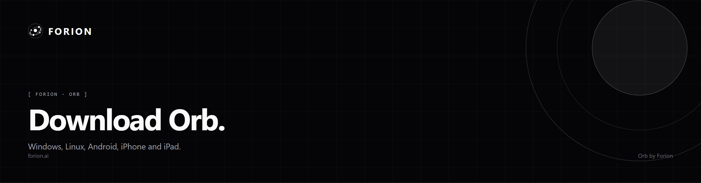
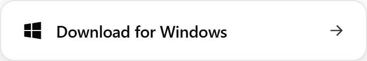
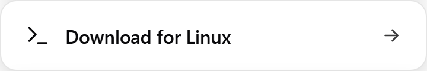
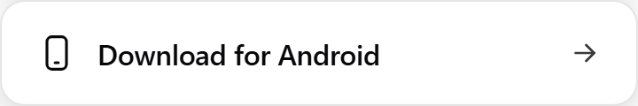
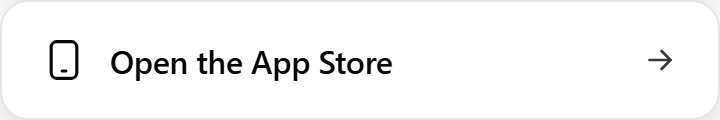

  

  <strong>Download Orb</strong> 
  Official builds from <a href="https://forion.ai">Forion</a>.

<table align="center">
  <tr>
    <td align="center" colspan="2">
      
    </td>
  </tr>
  <tr>
    <td align="center">
      
    </td>
    <td align="center">
      
    </td>
  </tr>
  <tr>
    <td align="center" colspan="2">
      
    </td>
  </tr>
</table>

  Desktop builds are unsigned test builds while signing is being prepared. Windows may show a security warning. Android installs are signed. The macOS build is coming soon.

  <a href="https://forion.ai">Forion</a> ·
  <a href="https://forion.ai/orb">Orb</a> ·
  <a href="https://forion.ai/docs">Docs</a> ·
  <a href="https://forion.ai/privacy">Privacy</a> ·
  <a href="mailto:hello@forion.dev">Contact</a> ·
  <a href="SECURITY.md">Security</a>

